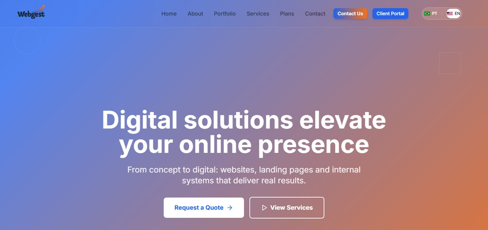

# Webgest Solutions — website

Bilingual (PT/EN) website for Webgest Solutions, the digital studio I co-founded. It presents the studio's services, plans and past work, and turns visitors into leads through a contact form and WhatsApp.

**Live:** https://webgest-site.vercel.app



## Features

- **Two languages:** Portuguese and English. Every string lives in `src/i18n/translations.ts`, and the English dictionary is type-checked against the Portuguese keys, so a missing translation is a type error.
- **Sections:** hero, services, why choose us, plans, portfolio, about, call to action and contact.
- **Lead capture:** the contact form posts each lead to the studio's API. A floating WhatsApp button stays on screen.
- **Portfolio cards:** link to the live client sites the studio has built.

## Tech stack

React 18 · TypeScript · Vite · Tailwind CSS · shadcn/ui (Radix UI) · React Router · Vercel

## Getting started

Requires Node.js 18 or newer.

```bash
npm install
npm run dev       # http://localhost:8080
```

| Script            | What it does                        |
| ----------------- | ----------------------------------- |
| `npm run dev`     | Dev server with hot reload          |
| `npm run build`   | Production build into `dist/`       |
| `npm run preview` | Serves the production build locally |
| `npm run lint`    | Runs ESLint                         |

## Project structure

```
src/
├── components/   # one component per section (Hero, Services, Plans, Portfolio, Contact…) and ui/ primitives
├── i18n/         # LanguageContext and the PT/EN translation dictionaries
├── pages/        # Index and NotFound
└── assets/       # images and logos
```

---

Built by [Heleno Matos](https://portfolio.helenomatos.com) at [Webgest Solutions](https://webgestsolutions.com.br).
